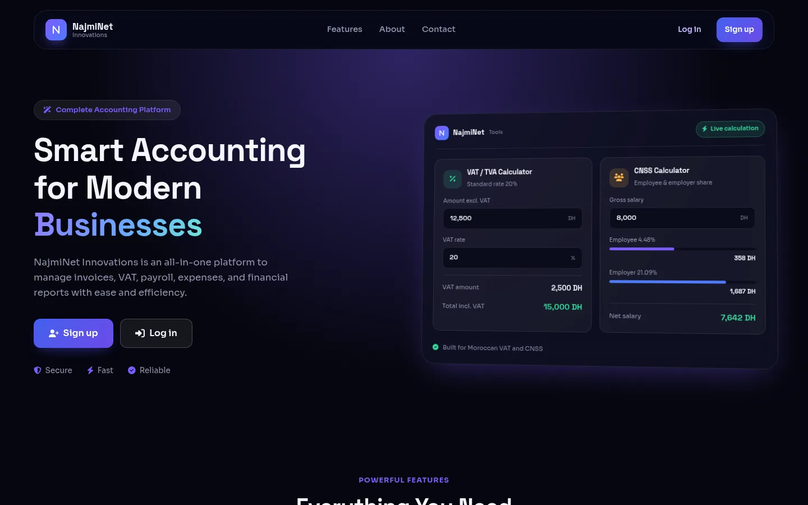
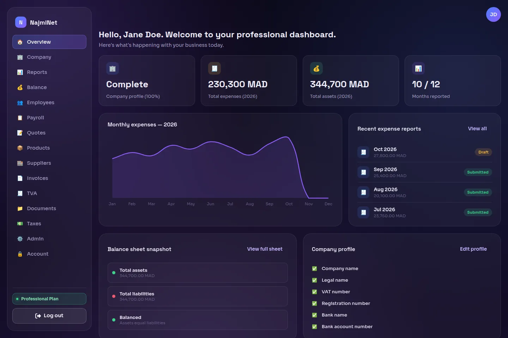
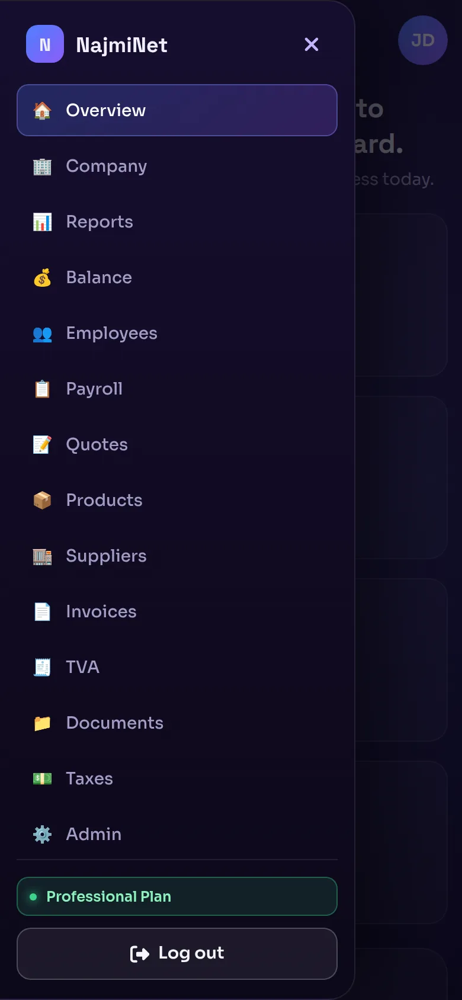
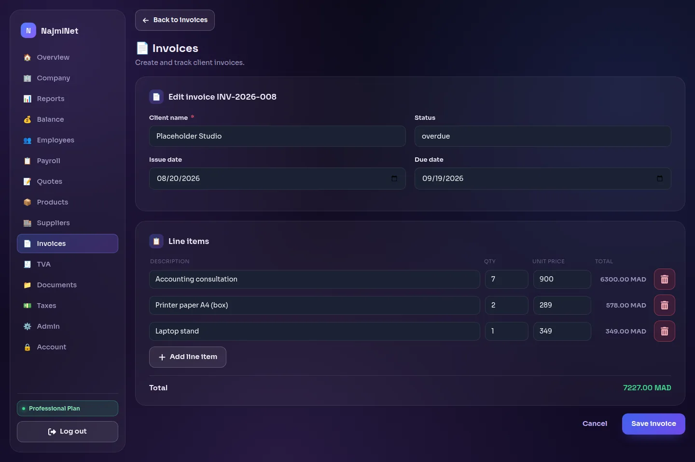
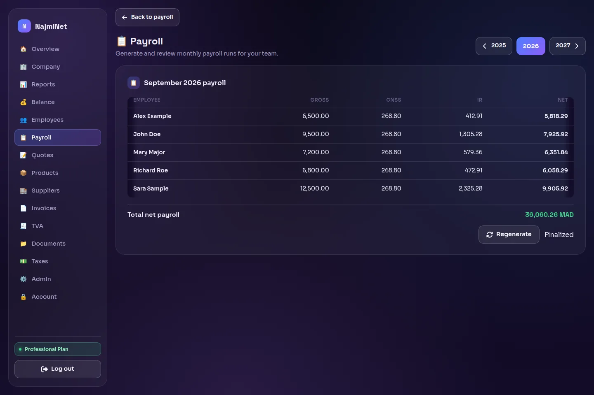
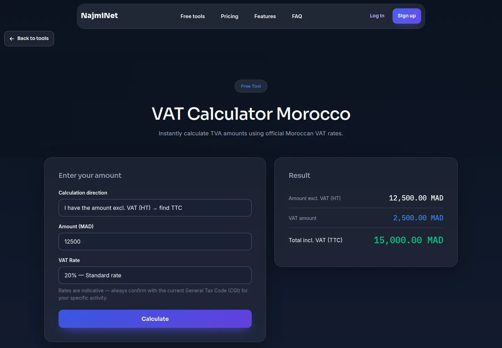
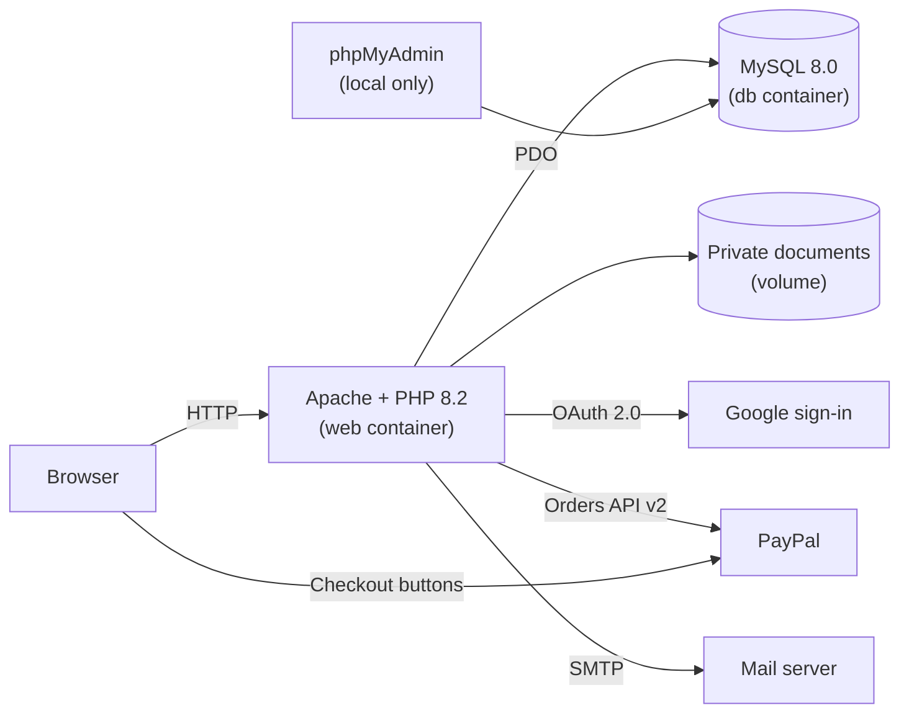

# NajmiNet

A financial management workspace for small Moroccan businesses: invoices, quotes, VAT (TVA), payroll, documents and reports in one place, plus free calculators anyone can use.


[](LICENSE)



| Dashboard (desktop) | Dashboard (mobile, menu open) |
|---|---|
|  |  |

| Invoice editor | Payroll |
|---|---|
|  |  |

| Free VAT calculator |
|---|
|  |

*Screenshots use made-up demo data.*

## Contents

- [Features](#features)
- [Tech stack and architecture](#tech-stack-and-architecture)
- [Getting started with Docker](#getting-started-with-docker)
- [Configuration](#configuration)
- [Third-party setup](#third-party-setup)
- [Database](#database)
- [Security](#security)
- [Roadmap](#roadmap)
- [Third-party assets](#third-party-assets)
- [Credits](#credits)
- [License](#license)

More: [development notes](docs/development.md) · [changelog](CHANGELOG.md)

## Features

### Free public tools (no account needed)

- **VAT calculator**: converts between amounts excluding and including tax at 20, 14, 10 or 7 %.
- **CNSS payroll calculator**: employee and employer CNSS and AMO contributions for a gross salary.
- **Income tax (IR) calculator**: annual and monthly income tax from a monthly or annual taxable income.
- **Invoice generator**: build an invoice with line items, then print it or save it as PDF from the browser.
- **Expense note builder**: list expenses and print the note.

### Dashboard (with a trial or subscription)

- **Overview**: key figures (company profile completion, total expenses, total assets, months reported), a monthly expenses chart, recent expense reports, a balance sheet snapshot and a profile checklist.
- **Invoices**: line items with automatic totals, issue and due dates, and a status (draft, pending, paid, overdue).
- **Quotes**: line items with automatic totals and a status (draft, sent, accepted, rejected).
- **Employees**: contact details, position, department, salary and hire date.
- **Payroll**: one run per month, generated from active employees with CNSS and income tax, then finalized. The formulas are simplified (see [Roadmap](#roadmap)).
- **Tax settings**: the CNSS rate and income tax brackets that payroll uses.
- **VAT (TVA) declarations**: one per quarter, with VAT collected, VAT deductible and the net amount due.
- **Expense reports**: a month-by-month grid with yearly totals.
- **Balance sheet**: simplified assets and liabilities with a balance check.
- **Documents**: private uploads (PDF, Office files, images; 10 MB maximum) that only their owner can download.
- **Products and suppliers**: product catalogue with prices and stock, and supplier contacts.
- **Company profile**: legal name, registration and VAT numbers, and bank information.
- **Reference data**: job positions, departments and contract types.

### Accounts and billing

- Sign-up with email and password (strong-password rules), or with Google.
- "Remember me", password reset by email, and "Log out of all devices".
- One 14-day free trial per account.
- Professional plan: a one-time PayPal payment for 30 days of access; nothing renews automatically.
- Newsletter with double opt-in, and a contact form whose messages are saved and emailed to the team.

## Tech stack and architecture

| Layer | Technology |
|---|---|
| Language | PHP 8.2, no framework |
| Database | MySQL 8.0 |
| Web server | Apache 2.4 with `mod_rewrite`, `mod_headers`, `mod_expires` |
| Front end | Bootstrap 5, vanilla JavaScript, Chart.js |
| Email | PHPMailer over SMTP (installed with Composer) |
| Payments | PayPal Orders API v2 |
| Sign-in | PHP sessions, Google OAuth 2.0 |
| Runtime | Docker and Docker Compose |



### Folder structure

```
.
├── auth/          Log in, sign up, password reset, Google sign-in
├── billing/       PayPal order creation and capture (server side)
├── classes/       Business logic; all SQL lives here, scoped to the signed-in user
├── dashboard/     Dashboard overview page, styles and scripts
├── docker/        Apache site config, PHP settings, MySQL entrypoint
├── docs/          Development notes and README screenshots
├── includes/      Database connection, sessions, env loader, security helpers, mailer, shared layout
├── middleware/    Sign-in and subscription guards for protected pages
├── newsletter/    Newsletter subscribe, confirm and unsubscribe
├── scripts/       Command-line helpers (SMTP test email)
├── sql/           Full schema (init.sql) and numbered migrations
├── tools/         The five free public calculators
├── assets/        CSS, JavaScript, fonts and self-hosted libraries
└── *.php          Public pages and dashboard pages (invoices.php, payroll.php, …)
```

## Getting started with Docker

### Prerequisites

- Docker Engine with the Compose plugin (`docker compose`)
- Git
- Free local ports 8080, 8081 and 3307

### 1. Clone

```bash
git clone https://github.com/ElFarisssaid19/Najminet.git
cd Najminet
```

### 2. Create the environment file

```bash
cp .env.local.example .env.local
```

Open `.env.local` and replace every placeholder (`change_me`, `your-…`, `you@example.com`) with your own values. See [Configuration](#configuration). `.env.local` is git-ignored and must never be committed.

### 3. Set the file permissions

```bash
chmod 640 .env.local
sudo chgrp 33 .env.local
```

Apache in the web container runs as `www-data` (user and group 33) and reads `.env.local` through the project's bind mount, so the file must be readable by group 33 and by no one else on the machine.

### 4. Build and start

```bash
docker compose up -d --build
```

The image installs the PHP dependencies with Composer. On the first start, MySQL creates the database, the app user and the root password from `.env.local`, then runs `sql/init.sql` to build the schema.

### 5. Open the app

| Service | URL |
|---|---|
| Website | http://localhost:8080 |
| phpMyAdmin | http://localhost:8081 (log in with `DB_USER` / `DB_PASS`) |
| MySQL | `localhost:3307` |

All three ports are bound to `127.0.0.1` on purpose, so they can't be reached from other machines on your network.

Create an account at http://localhost:8080/auth/register.php, then start the free trial from the pricing section to open the dashboard.

## Configuration

Every setting lives in `.env.local`; the template is [`.env.local.example`](.env.local.example).

| Key | What it's for | Where to get it |
|---|---|---|
| `APP_URL` | Base URL used in links inside emails (password reset, newsletter). Without it, reset emails aren't sent. | The address of your site, e.g. `http://localhost:8080` |
| `DB_HOST` | MySQL host | `db` with Docker, `127.0.0.1` without |
| `DB_PORT` | MySQL port (optional, default 3306) | Your MySQL server |
| `DB_NAME` | Database name | Choose one; Docker creates it on the first start |
| `DB_USER` | Database user for the app | Choose one; Docker creates it on the first start |
| `DB_PASS` | That user's password | Choose a strong password |
| `MYSQL_ROOT_PASSWORD` | MySQL root password (Docker only) | Choose a strong password |
| `MAIL_HOST` | SMTP server | Your email provider ([Gmail](#gmail-smtp-with-an-app-password): `smtp.gmail.com`) |
| `MAIL_PORT` | SMTP port | Your email provider (Gmail: 587) |
| `MAIL_ENCRYPTION` | `tls` (STARTTLS) or `ssl` | Your email provider (Gmail: `tls`) |
| `MAIL_USERNAME` | SMTP login | Your mailbox address |
| `MAIL_PASSWORD` | SMTP password | Your email provider ([Gmail: an App Password](#gmail-smtp-with-an-app-password)) |
| `MAIL_FROM` | Sender address | Usually the same mailbox as `MAIL_USERNAME` |
| `MAIL_FROM_NAME` | Sender name shown in emails | Your choice |
| `MAIL_REPLY_TO` | Reply-To address (optional, defaults to `MAIL_FROM`) | Your choice |
| `CONTACT_TO` | Mailbox that receives contact-form messages (optional, defaults to `MAIL_FROM`) | Your choice |
| `CONTACT_EMAIL` | Public email address shown on the contact page (optional). When empty, or still the `example.com` placeholder, the email block is hidden. | Your business email |
| `CONTACT_WHATSAPP` | WhatsApp number for the "Chat on WhatsApp" links on the contact page and in the footer (optional). International format, digits only, e.g. `2126XXXXXXXX`. When empty, the links are hidden. | Your business WhatsApp number |
| `NEWSLETTER_ADMIN_EMAIL` | Notified when a newsletter subscriber confirms (optional) | Your choice |
| `PAYPAL_MODE` | `sandbox` for testing, `live` for real payments | — |
| `PAYPAL_CLIENT_ID` | PayPal REST app client ID | [PayPal developer dashboard](#paypal-sandbox) |
| `PAYPAL_CLIENT_SECRET` | PayPal REST app secret | [PayPal developer dashboard](#paypal-sandbox) |
| `PAYPAL_MERCHANT_ID` | The PayPal account that must receive payments. Checkout is refused while it is empty, and payments to any other account are rejected. | [PayPal account details](#paypal-sandbox) |
| `GOOGLE_CLIENT_ID` | Google OAuth client ID | [Google Cloud console](#google-oauth-client) |
| `GOOGLE_CLIENT_SECRET` | Google OAuth client secret | [Google Cloud console](#google-oauth-client) |
| `GOOGLE_REDIRECT_URI` | Where Google sends the user back after sign-in | `<APP_URL>/auth/oauth/google.php` |

`STRIPE_SECRET_KEY` and `STRIPE_PROFESSIONAL_PRICE_ID` are only read by the old Stripe checkout, which is switched off; you don't need them.

## Third-party setup

### Google OAuth client

1. In the [Google Cloud console](https://console.cloud.google.com/), create or pick a project.
2. Configure the OAuth consent screen (app name, support email, and the `openid`, `email` and `profile` scopes).
3. Go to **APIs & Services → Credentials → Create credentials → OAuth client ID** and choose **Web application**.
4. Under **Authorized redirect URIs**, add your site's address followed by `/auth/oauth/google.php`, for example `http://localhost:8080/auth/oauth/google.php`.
5. Copy the client ID and secret into `GOOGLE_CLIENT_ID` and `GOOGLE_CLIENT_SECRET`, and the same redirect URI into `GOOGLE_REDIRECT_URI`.

Only Google accounts with a verified email address can sign in.

### PayPal sandbox

1. Sign in at [developer.paypal.com](https://developer.paypal.com/) and open **Apps & Credentials** in **Sandbox** mode.
2. Create an app of type **Merchant**. Copy its client ID and secret into `PAYPAL_CLIENT_ID` and `PAYPAL_CLIENT_SECRET`, and set `PAYPAL_MODE=sandbox`.
3. Open **Testing Tools → Sandbox Accounts**, then the **Business** account the app belongs to. Its **Account ID** is the merchant ID: put it in `PAYPAL_MERCHANT_ID`.
4. To pay, log in to the PayPal window with the sandbox **Personal** account from the same page.

For real payments, create a **Live** app and use the merchant ID shown in your PayPal business account's settings (**Account settings → Business information**).

### Gmail SMTP with an App Password

1. Turn on 2-Step Verification for the Google account.
2. Create an App Password at [myaccount.google.com/apppasswords](https://myaccount.google.com/apppasswords).
3. Set `MAIL_HOST=smtp.gmail.com`, `MAIL_PORT=587` and `MAIL_ENCRYPTION=tls`, then put the Gmail address in `MAIL_USERNAME` and `MAIL_FROM`.
4. Put the 16-character App Password, without spaces, in `MAIL_PASSWORD`. Your normal Google password won't work.

To check the settings, send a test email: `docker compose exec web php scripts/send-test-email.php you@example.com`.

## Database

- **Fresh install:** [`sql/init.sql`](sql/init.sql) holds the full schema. With Docker, MySQL runs it automatically the first time the database volume is empty.
- **Upgrading an existing database:** the numbered files `sql/000_…sql` to `sql/014_…sql` are migrations. Apply them in order. Each one is safe to run again, so you can run them all:

```bash
DB_USER="$(grep '^DB_USER=' .env.local | cut -d= -f2-)"
DB_NAME="$(grep '^DB_NAME=' .env.local | cut -d= -f2-)"
export MYSQL_PWD="$(grep '^DB_PASS=' .env.local | cut -d= -f2-)"
for f in sql/0*.sql; do
  docker compose exec -T -e MYSQL_PWD db mysql -u "$DB_USER" "$DB_NAME" < "$f"
done
unset MYSQL_PWD
```

More database tasks (reset, change a password, back up documents) are in the [development notes](docs/development.md#common-docker-tasks).

## Security

- **CSRF protection** on every form, and on the PayPal endpoints through an `X-CSRF-Token` header.
- **Rate limiting** (HTTP 429) on sign-in (per IP address and per email), sign-up, password reset, the contact form and the newsletter.
- **Password policy**: at least 12 characters with upper and lower case, digits and symbols. Common passwords, and passwords built from the user's name or email, are refused.
- **Sessions**: password reset tokens are hashed, single-use and expire after 30 minutes. Resetting a password signs the account out on every device. "Remember me" tokens are stored hashed.
- **PayPal verified on the server**: the order is created server-side with the price set in code. The capture is checked for owner, status, amount, currency and receiving account, and each payment activates a subscription only once.
- **Private document storage**: files are kept outside the web root and served only to their owner, as downloads.
- **Data isolation**: every query is a prepared statement filtered by the signed-in user.
- **Errors are logged, never shown** to visitors.
- **Sensitive paths blocked**: Apache denies dotfiles, `vendor/`, `sql/`, `classes/`, `includes/`, `middleware/`, `scripts/`, `docker/`, `uploads/`, Composer and Docker files, and `.md`, `.sql`, `.sh`, `.log` and `.txt` files (except `robots.txt`). Directory listings are off.
- **Secrets** live only in the git-ignored `.env.local`, and the Docker ports listen on `127.0.0.1` only.

### Reporting a vulnerability

Please don't open a public issue. Use GitHub's private vulnerability reporting instead: **Security → Report a vulnerability** on this repository.

## Roadmap

Not built yet:

- **Change password** from the account page (today the only way is a password reset by email).
- **Recurring billing**: the Professional plan is a one-time payment for 30 days.
- **Payroll improvements**: the CNSS and income tax formulas are simplified. AMO, the professional-expenses deduction and family charges aren't included, and the rates must be checked against current law before real use.
- **PDF export** of invoices and quotes from the dashboard (the free invoice generator relies on the browser's "Save as PDF").
- **Automated tests and CI**.

## Third-party assets

Served from this repository. Each keeps its license header, and its license file sits next to it.

| Asset | Version | Location | License |
|---|---|---|---|
| Bootstrap (CSS + JS bundle) | 5.3.2 | `assets/vendor/bootstrap-5.3.2/` | MIT (`LICENSE`) |
| Font Awesome Free | 6.5.1 | `assets/vendor/fontawesome-6.5.1/`; the button icons in `assets/css/buttons.css` are its SVG shapes | Icons CC BY 4.0, fonts SIL OFL 1.1, code MIT (`LICENSE.txt`) |
| Chart.js (UMD build) | 4.4.0 | `assets/vendor/chartjs-4.4.0/` | MIT (`LICENSE.md`) |
| Sora | Google Fonts v17 | `assets/fonts/` | SIL OFL 1.1 (`OFL-sora.txt`) |
| Space Grotesk | Google Fonts v22 | `assets/fonts/` | SIL OFL 1.1 (`OFL-spacegrotesk.txt`) |
| Inter | Google Fonts v20 | `assets/fonts/` | SIL OFL 1.1 (`OFL-inter.txt`) |
| IBM Plex Mono | Google Fonts v20 | `assets/fonts/` | SIL OFL 1.1 (`OFL-ibmplexmono.txt`) |

Changes from the upstream files:

- Source-map comments are removed (the maps are not shipped).
- Chart.js is the cdnjs minified build the site used before, with the official v4.4.0 license banner put back (cdnjs strips it).
- Font Awesome keeps only its solid and regular woff2 fonts, subset to the icons the site uses.
- The fonts keep only the latin and latin-ext subsets.

PHP dependencies (PHPMailer) are installed by Composer and are not in the repository.

## Credits

Developed by Said El Fariss (GitHub: [ElFarisssaid19](https://github.com/ElFarisssaid19)) during an internship at NajmiNet Innovations.

## License

Released under the [MIT License](LICENSE). Copyright (c) 2026 Said El Fariss and NajmiNet Innovations.

Third-party assets keep their own licenses (see [Third-party assets](#third-party-assets)).
